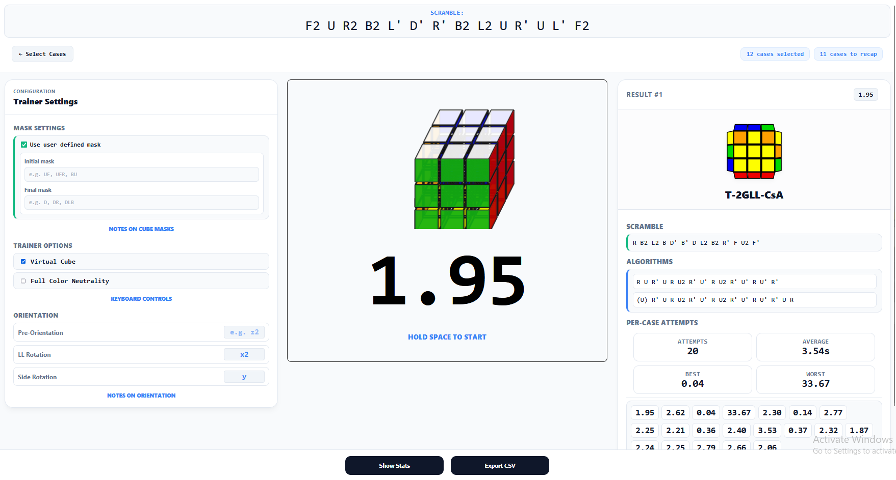

# ZBTrain

[](https://opensource.org/licenses/MIT)


An algorithm trainer for the ZB Method (ZBLS and ZBLL) that I personally created using HTML, CSS, and JavaScript. This project unifies the best features of existing trainers,
such as [Tao Yu’s Algorithm trainer](https://tao-yu.github.io/Alg-Trainer/) and [Roman's bestsiteever](https://bestsiteever.net/zbll/#/select) into a single trainer optimized for
high-volume drilling and long-term retention, with a virtual cube, smart cube support and spaced repetition.



> [!NOTE]
> This project is a work in progress. Everything is saved in your browser (localStorage), so your progress stays on the device and browser you use.

## Features

### Trainers
* **ZBLL Trainer:** All 472 ZBLL cases (T, U, L, H, Pi, Sune, Antisune). Pick whole sets, subsets or single cases, and save your selections as presets.
* **ZBLS Trainer:** All 302 ZBLS cases (F2L 1–41), with presets.
* **LSLL Trainer:** A random ZBLS case followed by whatever last layer it leaves you, similar to csTimer's LSLL. After each solve it shows which ZBLS and ZBLL case came up, which of your algs you used for each, and how long each part took.
* **BH Trainer:** Train BH recognition with only the BH stickers shown (the top face, the front-right corner and its two edges), so you can't fall back on blocks. Name mode asks for one of the 12 BH patterns (rename them to the names you learnt); Case mode asks which case of a subset you see, at the case picture's angle, your standard angle or any angle; Story mode asks for the pattern at each of the 4 corners of a whole ZBLL; By pattern mode turns the 36 front-right patterns (12 patterns × 3 corner twists) into presets and drills every ZBLL at every angle that shows them, recognised from two sides. Solve on the virtual cube or a smart cube, or use the scramble on a real cube. Keeps your score, streak and accuracy per pattern.
* **Learning Mode (spaced repetition):** Learn a few cases a day with Anki-style scheduling. Pick the subsets or single cases you want to learn, mark the ones you already know, and get a daily queue of new cases and reviews. After each solve the trainer suggests a rating (Again, Hard, Good, Easy) from your solve, and you can change it. Includes streaks, progress ("142 / 472 known") and a goal time.

### Virtual Cube and Smart Cube
* **Virtual Cube:** No scrambling needed: solve with the keyboard for massive training volume. Custom keybinds (QWERTY, Dvorak, Colemak and Colemak-DH layouts).
* **Smart Cube Support:** Connect a GAN, MoYu, QiYi, GoCube or Giiker smart cube over Bluetooth and solve on it. Needs a Chromium browser (Chrome, Edge, Opera); on iPhone and iPad, use the Bluefy browser.
* **Cube Views:** Classic 3D, isometric, top, qCube, qLast, q2Look and net, for both the virtual cube and the case image.
* **Continuous Training:** Like csTimer: the next case starts on its own after each solve.
* **Cube Masking, Color Neutrality, and Recall Mode:** Mask stickers, practise color neutral, or grey out the last layer after your first move to train recall instead of recognition.

### Algorithms
* **AUF-adjusted Algs:** Every alg is shown with the exact pre-AUF and post-AUF for the scramble you got.
* **Alg Player:** Watch any alg (or replay any of your solves) step by step on a cube, with a speed slider.
* **Alg Detection:** The trainer works out which alg you used, even with mistakes you undid, and lets you make it your main alg or add a new one.
* **Case Info Window:** Click a case (or the ⓘ button) for its picture, a setup scramble, every alg with the right AUF, your stats on it, and which alg you usually use.
* **Alg Sheets:** Import algs from a Google Sheets link, an Excel/CSV file or a pasted list. Each alg is checked to see which ZBLL or ZBLS case it actually solves, so sheets don't need to use our case names. Turn sheets on or off, or remove them.
* **Top Solvers' Algs:** A built-in sheet of the ZBLL and ZBLS algs Xuanyi Geng, Qixian Cao and Tymon Kolasiński used in their reconstructed solves. The case info window shows which of them used each alg, with links to the solves on reco.nz. Collected by [Yota Ueda](https://x.com/zbller) in [this sheet](https://docs.google.com/spreadsheets/d/1wYaKvm1FQ8ZAJ4I_te8N75rowwn-9lgB1A8M8khfxVA); newer solves are added from [reco.nz](https://reco.nz/) with `node tools/updateTopSolvers.js`.
* **Export:** Export your algs to Excel, CSV or a printable PDF with each case's picture.

### Statistics
* **Per-case and Per-set Statistics:** Average, best and worst times, recognition and execution splits, turns, TPS and fluidity, grouped by set with checkboxes to choose which sets to show. Export your solves as CSV.
* **Recognition and Execution Split:** Your first move ends recognition, so you can see which one is your bottleneck.
* **Trouble Spots:** See where in an alg you usually pause or make mistakes.
* **Slow Cases:** List the cases above a time you choose and drill just those.
* **Weighted Case Order:** Slower cases come up more often (like solved.no's weighted mode).
* **Heatmap:** Color-code the case selection by your average time.

## Running it locally
ZBTrain is plain HTML, CSS and JavaScript with no build step. Serve the folder with any local web server, for example:

```bash
python -m http.server 5510
```

Then open http://localhost:5510.

## Credits
I would like to to thank the following people for contributing to my project (directly, and indirectly): <br />

* crystalcube for being such a good mentor, especially in JavaScript. I still am getting the hang of JavaScript since I've only used it in one previous project so far. <br />
* Roman Strakhov for having the casemap for both algorithms and scrambles, it saved a lot of mental load from me having to generate them myself. <br />
* namisama for letting me use the features I always wanted to implement in my trainer (color neutrality, presets, masks, etc.) <br />
* Morgan Yeh for some of the inspiration from his ZBLS trainer. <br />
* Harry Richman for some of the code in the virtual cube, really useful and also saved me some mental load on creating my own! <br />
* masadl for some of the functions in presets, and giving inspiration from his ZB trainer. <br />
* USSB for the moral support, go check out his [website](https://solved.no)).

## Third-party code
* smartcube-web-bluetooth by Pau Oliva and Andy Fedotov for smart cube connections (MIT), bundled with aes-js, lz-string and RxJS. See [vendor/THIRD_PARTY_LICENSES.txt](vendor/THIRD_PARTY_LICENSES.txt).
* [SheetJS](https://sheetjs.com/) for reading and writing Excel files (Apache-2.0), loaded only when you use Excel import or export.
